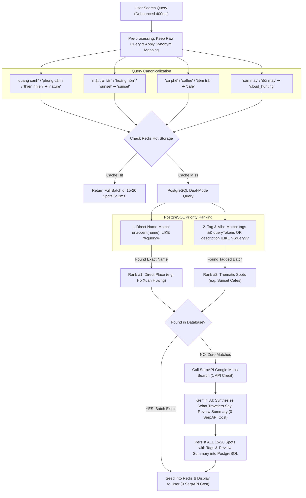

# Engineering Specification & Implementation Plan: TripSpotExplorer & Multi-Tier Caching

> **UI Reference**: [design/src/App.tsx](file:///d:/ALL_SOURCE_CODE/Projects/TravelPlanning/design/src/App.tsx) (`TripSpotExplorer`, `TripItineraryDetails`, `TripDetail`)  
> **External Providers**: 
> - [SerpAPI Google Maps API](https://serpapi.com/google-maps-api) (Free Tier: 250 requests/month) for place discovery.
> - **Google Gemini API** ([GeminiService.java](file:///d:/ALL_SOURCE_CODE/Projects/TravelPlanning/backend/src/main/java/com/travelplanning/backend/services/external/GeminiService.java)) for synthesizing traveler review snapshots without burning SerpAPI review credits.  
> **Core Architecture**: **Dual-Mode Multi-Tier Search Engine with Gemini Review Synthesis** (Frontend Debounce ➔ Stopword Normalization & Synonym Mapping ➔ 🔴 Hot Storage [Redis] ➔ 🔵 Cold Storage [PostgreSQL Dual-Mode Query] ➔ 🌐 SerpAPI Batch Engine ➔ 🤖 Gemini Review Snapshot)

---

## 1. Executive Summary & Core Principles

This specification details the architecture for the **TripSpotExplorer** component embedded inside the **Trip Detail** workspace (`TripDetailPage`). It enables users to discover, search, review, and schedule places into their current itinerary while protecting our strict 250 requests/month SerpAPI quota.

### Key Architectural Pillars:
1. **Dual-Mode Search with Priority Ranking**:
   - **Mode A (Exact Place Names)**: Proper nouns (*"Hồ Xuân Hương"*, *"Dinh Bảo Đại"*, *"Chợ đêm"*) match directly on `places.name` and are ranked at **Priority #1**.
   - **Mode B (Thematic / Vibe Queries)**: Emotional or descriptive queries (*"quán cafe ngắm hoàng hôn"*, *"lẩu bò ngon"*) match on structured `places.tags` and `places.description`.
2. **Gemini AI Review Synthesis (0 SerpAPI Review Calls)**:
   - Because SerpAPI charges 1 full search credit per place to fetch reviews, we **never** call SerpAPI's review endpoint.
   - Instead, we leverage our existing **Google Gemini API** (`GeminiService`) to synthesize authentic 1-sentence traveler review snapshots (*"What travelers say"*) based on place name, category, rating, and tags. This saves 20 credits per search!
3. **Synonym Mapping in Query Canonicalization**:
   - Common travel synonyms (*"quang cảnh"*, *"phong cảnh"*, *"thiên nhiên"*, *"cảnh đẹp"*) are mapped to a single canonical concept (`nature`) in `QueryCanonicalizer`.
   - Different users typing synonymous phrasings hit the **exact same Redis cache key**, achieving near-100% cache efficiency without separate network requests.
4. **Clean Tag System (Zero Tag Pollution)**:
   - Tags originate **exclusively from Google Maps structured attributes** (`types`, `amenities`, Google Maps category badges).
   - Arbitrary user search text is **never** dumped into a place's tag array, ensuring places maintain their distinct, clean identities.
5. **Batch-Based Delivery & Storage**:
   - When SerpAPI is invoked, it returns **15 to 20 places**. We **persist 100% of the batch** into PostgreSQL and cache it into Redis.
   - Users are always presented with a generous batch of 15–20 spots, maximizing variety and minimizing repetitive searches.
6. **Unified "Xem thêm" (Load More) Pagination**:
   - To keep the interface clean and intuitive, users get more spots simply by clicking **"Xem thêm" (Load More)**.
   - **Step 1 (DB First)**: The button loads the next batch from the local PostgreSQL database (e.g., spots 16–30) at **0 SerpAPI cost**.
   - **Step 2 (Auto-Fetch from SerpAPI)**: Only when the local database runs out of spots for that topic does clicking "Xem thêm" transparently fetch the next page from SerpAPI (`start = page * 20`), persist the new 20 spots, and append them to the list.
7. **Microscopic Database Footprint**:
   - Even with thousands of places saved across Vietnam, 5,000 places consume only **~7.5 MB** of disk space, fitting entirely in RAM memory buffers for $< 1\text{ ms}$ query latency.

---

## 2. Dual-Mode Search Engine Architecture & Gemini Synthesis



---

## 3. Review Summary Strategy: Gemini AI Snapshot

### 3.1. Why Gemini over SerpAPI Reviews API?
* **SerpAPI Review Endpoint**: Costs **1 search credit per place**. Fetching reviews for 20 places would consume 20 extra credits per search.
* **Gemini Solution**: We already have `GeminiService` configured with Google's generous quota. Gemini synthesizes a tailored 1-sentence traveler perspective based on the place's name, rating, category, and location.

### 3.2. Gemini Review Snapshot Prompt (`GeminiService.java`)
```java
public String generateReviewSnapshot(String placeName, PlaceType type, Float rating, String area, List<String> tags) {
    String prompt = String.format("""
        Bạn là chuyên gia du lịch am hiểu đánh giá cộng đồng. Hãy viết đúng 1 câu ngắn gọn tóm tắt "Khách du lịch nói gì?" về địa điểm sau:
        - Tên: %s
        - Loại hình: %s
        - Đánh giá: %.1f sao
        - Khu vực: %s
        - Đặc trưng: %s
        
        Yêu cầu:
        1. Đúng 1 câu súc tích (15-25 từ).
        2. Mang giọng điệu lời khuyên thực tế của du khách (ví dụ: "Khung cảnh đẹp, dễ đi và nên đến trước 9 giờ để tránh đông").
        3. Chỉ trả về 1 câu văn duy nhất, không thêm ngoặc kép, không thêm tiêu đề.
        """, placeName, type, rating != null ? rating : 4.5f, area != null ? area : "trung tâm", tags != null ? String.join(", ", tags) : "");
    
    return callGemini(prompt).trim();
}
```

---

## 4. Database Schema Design (Flyway `V4`)

File: `backend/src/main/resources/db/migration/V4__enhance_places_and_add_trip_saved.sql`

```sql
-- 1. Enhance places table with complete metadata, gallery, and tags
ALTER TABLE places
    ADD COLUMN IF NOT EXISTS destination_id UUID REFERENCES destinations(id) ON DELETE SET NULL,
    ADD COLUMN IF NOT EXISTS thumbnail_url TEXT,
    ADD COLUMN IF NOT EXISTS photo_urls TEXT[],
    ADD COLUMN IF NOT EXISTS reviews_count INT DEFAULT 0,
    ADD COLUMN IF NOT EXISTS price_level VARCHAR(100),
    ADD COLUMN IF NOT EXISTS open_hours VARCHAR(100),
    ADD COLUMN IF NOT EXISTS area VARCHAR(200),
    ADD COLUMN IF NOT EXISTS distance_info VARCHAR(100),
    ADD COLUMN IF NOT EXISTS description TEXT,
    ADD COLUMN IF NOT EXISTS review_summary TEXT,           -- Populated by Gemini AI Snapshot
    ADD COLUMN IF NOT EXISTS tags TEXT[],
    ADD COLUMN IF NOT EXISTS google_place_id VARCHAR(255),
    ADD COLUMN IF NOT EXISTS data_id VARCHAR(255),
    ADD COLUMN IF NOT EXISTS created_at TIMESTAMPTZ NOT NULL DEFAULT now(),
    ADD COLUMN IF NOT EXISTS updated_at TIMESTAMPTZ NOT NULL DEFAULT now();

CREATE INDEX IF NOT EXISTS idx_places_destination_id ON places(destination_id);
CREATE INDEX IF NOT EXISTS idx_places_google_place_id ON places(google_place_id);
CREATE INDEX IF NOT EXISTS idx_places_data_id ON places(data_id);
CREATE INDEX IF NOT EXISTS idx_places_tags ON places USING GIN(tags);

-- 2. Table for trip-specific bookmarks ("Saved Options")
CREATE TABLE IF NOT EXISTS trip_saved_places (
    trip_id UUID NOT NULL REFERENCES trips(id) ON DELETE CASCADE,
    place_id UUID NOT NULL REFERENCES places(id) ON DELETE CASCADE,
    notes TEXT,
    saved_at TIMESTAMPTZ NOT NULL DEFAULT now(),
    PRIMARY KEY (trip_id, place_id)
);
CREATE INDEX IF NOT EXISTS idx_trip_saved_places_trip_id ON trip_saved_places(trip_id);
```

---

## 5. UI/UX Flow & Component Alignment (from `design/src/App.tsx`)

```
┌────────────────────────────────────────────────────────────────────────────┐
│ 1. Trip Overview & Detail Screen (TripDetailPage)                         │
│    - Header cover, date range, members, budget                             │
│    - Section 1: TripItineraryDetails (Timeline overview across days)       │
│    - Section 2: TripSpotExplorer (Interactive place discovery module)      │
│    - Aside: Saved Options widget (renders trip_saved_places)               │
└─────────────────────────────────────┬──────────────────────────────────────┘
                                      │
                                      ▼
┌────────────────────────────────────────────────────────────────────────────┐
│ 2. Discovery Module (TripSpotExplorer)                                     │
│    - Category Filter Tabs: All | Nature | Culture | Check-in | Architecture│
│    - Real-time search with 400ms debounce                                  │
│    - Grid of Spot Cards: Displays initial batch of 15-20 cards             │
│    - Bottom Button: "Xem thêm" (Load More)                                 │
│      + Paginates from DB pool first (0 SerpAPI cost)                       │
│      + If local DB runs out, automatically fetches next 20 from SerpAPI    │
└─────────────────────────────────────┬──────────────────────────────────────┘
                                      │
                   ┌──────────────────┴──────────────────┐
                   ▼                                     ▼
┌──────────────────────────────────────┐ ┌───────────────────────────────────┐
│ 3A. Spot Detail Drawer               │ │ 3B. Bookmark Action               │
│     (Triggered by clicking card)     │ │     (Clicking bookmark icon)      │
│ - Right-side slide-over drawer       │ │ - Calls POST /saved-places        │
│ - Photo gallery (1 main + sub-photos)│ │ - Updates "Saved Options" in aside│
│ - Open hours, cost, distance         │ └───────────────────────────────────┘
│ - "What travelers say" quote snapshot│
│   (Rendered from places.reviewSummary)│
│ - Action: "Add to itinerary" button  │
└──────────────────┬───────────────────┘
                   │
                   ▼
┌────────────────────────────────────────────────────────────────────────────┐
│ 4. Add to Itinerary Modal (SpotAddModal)                                   │
│    - Dropdown: Select Day [Day 1 · Oct 12, Day 2 · Oct 13...]              │
│    - Input: Select Time [09:30]                                            │
│    - Preview block: [09:30 · Spot Name (Category · Price)]                 │
│    - Action: "Confirm Add" ➔ Calls POST /activities                        │
│    - Immediate Feedback:                                                   │
│      + Spot card changes to badge: "✓ Added"                               │
│      + Success banner notification appears                                 │
│      + TripItineraryDetails timeline updates automatically                 │
└────────────────────────────────────────────────────────────────────────────┘
```

---

## 6. Phased Implementation Roadmap

```
┌────────────────────────────────────────────────────────────────────────────┐
│ Phase 1: Database Migration (Flyway V4) & JPA Repositories                 │
│ Phase 2: Redis Config, Gemini Review Snapshot, Dual-Mode & SerpAPI Service │
│ Phase 3: Trip Activity Management & Bookmark APIs                          │
│ Phase 4: Frontend UI Port (TripSpotExplorer & TripItineraryDetails)        │
└────────────────────────────────────────────────────────────────────────────┘
```

### 📌 Phase 1: Database Migration & Repositories (Backend)
- [x] Create `V4__enhance_places_and_add_trip_saved.sql` with DDL in Section 4.
- [x] Update [Place.java](file:///d:/ALL_SOURCE_CODE/Projects/TravelPlanning/backend/src/main/java/com/travelplanning/backend/entities/Place.java) with new fields (`tags`, `thumbnailUrl`, `photoUrls`, `reviewsCount`, `priceLevel`, `openHours`, `area`, `distanceInfo`, `description`, `reviewSummary`, `googlePlaceId`, `dataId`).
- [x] Create `TripSavedPlace.java` entity with composite key (`tripId`, `placeId`).
- [x] Implement Spring Data JPA repositories with explicit SQL and documentation comments:
  - `PlaceRepository`: Dual-mode query `searchPlaces(UUID destinationId, String rawQuery, String[] tokens, boolean hasTokens, Pageable pageable)` with unaccent and array overlap.
  - `TripSavedPlaceRepository`: `existsByIdTripIdAndIdPlaceId`, `findAllByTripIdWithPlaceDetails`, atomic delete.
  - `TripDayRepository`: Sequential day ordering and max day number computation.
  - `ActivityRepository`: Ordered trip activity fetch, next position index computation, and `isPlaceScheduledInTrip`.

---

### 📌 Phase 2: Redis Config, Gemini Review Snapshot & Spot Discovery (Backend)
- [x] Add `spring-boot-starter-data-redis` and `spring-boot-starter-cache` to [build.gradle.kts](file:///d:/ALL_SOURCE_CODE/Projects/TravelPlanning/backend/build.gradle.kts).
- [x] Create `CacheConfig.java`: Configure `RedisCacheManager` with Jackson JSON serialization and 14-day TTL.
- [x] Implement `QueryCanonicalizer.java`: Strips conversational stopwords and maps synonyms (*"quang cảnh"* $\rightarrow$ *"nature"*, *"hoàng hôn"* $\rightarrow$ *"sunset"*).
- [x] Enhance [GeminiService.java](file:///d:/ALL_SOURCE_CODE/Projects/TravelPlanning/backend/src/main/java/com/travelplanning/backend/services/external/GeminiService.java):
  - Add `generateReviewSnapshot(placeName, type, rating, area, tags)` for instant 1-sentence traveler sentiment synthesis.
- [x] Implement `SerpApiService.java`:
  - Calls `https://serpapi.com/search.json?engine=google_maps&hl=vi&gl=vn`.
  - Supports `start` parameter for pagination (`start=0`, `start=20`, etc.).
  - Includes `serpapi.mock-mode=true` switch using embedded JSON mock data for local development.
  - Parser for both `local_results` (array of 15–20 spots) and `place_results` (single object).
- [x] Implement `SpotDiscoveryService.java`:
  - `getSpotsByDestination(UUID destId, String category, int page)`: DB-first batch lookup, seeds initial top attractions batch if empty.
  - `searchSpots(UUID destId, String rawQuery, int page)`:
    - Step 1: Check Redis using canonical key.
    - Step 2: If page exists in local storage, return it directly (**0 SerpAPI calls**).
    - Step 3: If local storage has exhausted its spots, call SerpAPI with `start = page * 20`, synthesize review summaries using Gemini concurrently on Java 21 Virtual Threads, save spots into PostgreSQL with clean Google tags, cache in Redis, and return.
- [x] Create `SpotController.java`:
  - `GET /api/v1/destinations/{destId}/spots?page={page}`
  - `GET /api/v1/destinations/{destId}/spots/search?q={query}&page={page}`
  - `GET /api/v1/spots/{spotId}`

---

### 📌 Phase 3: Trip Activity Management & Bookmark APIs (Backend)
- [x] Implement `TripDetailService.java`:
  - `getFullTripDetails(UUID tripId)`: Returns complete payload including trip metadata, days, ordered activities, and bookmarked places.
  - `addDay(UUID tripId)` & `deleteDay(UUID tripId, UUID dayId)`
- [x] Implement `ActivityManagementService.java`:
  - `addSpotToDay(UUID tripId, AddSpotToDayRequest req)`: Inserts a new `Activity` linked to `trip_day` and `place` at position `max(position) + 1`.
  - `deleteActivity(UUID activityId)`: Removes an item from the day timeline.
  - `bookmarkSpot(UUID tripId, UUID placeId)`: Adds to `trip_saved_places`.
  - `removeBookmarkedSpot(UUID tripId, UUID placeId)`: Deletes from `trip_saved_places`.
  - `getBookmarkedSpots(UUID tripId)`: Lists all saved places.
- [x] Create REST endpoints in `TripDetailController.java` and `ActivityController.java`:
  - `GET /api/v1/trips/{tripId}/full-details`
  - `POST /api/v1/trips/{tripId}/days`
  - `DELETE /api/v1/trips/{tripId}/days/{dayId}`
  - `POST /api/v1/trips/{tripId}/days/{dayId}/activities`
  - `DELETE /api/v1/trips/{tripId}/activities/{activityId}`
  - `POST /api/v1/trips/{tripId}/saved-places/{placeId}`
  - `DELETE /api/v1/trips/{tripId}/saved-places/{placeId}`
  - `GET /api/v1/trips/{tripId}/saved-places`

---

### 📌 Phase 4: Frontend UI Port & API Wiring (Frontend)
- [x] Port and modularize components from [design/src/App.tsx](file:///d:/ALL_SOURCE_CODE/Projects/TravelPlanning/design/src/App.tsx) into [frontend/src/pages/detail/](file:///d:/ALL_SOURCE_CODE/Projects/TravelPlanning/frontend/src/pages/detail/):
  - `TripItineraryDetails.tsx`: Multi-day timeline overview and interactive single-day view with delete/add day actions.
  - `TripSpotExplorer.tsx`: Search input with clear button, category filter pills, spot cards grid, and **"Xem thêm" (Load More)** pagination.
  - Slide-over detail drawer with photo gallery, metadata facts, and Gemini traveler sentiment snapshot ("Khách du lịch nói gì?").
  - Add to itinerary modal with day dropdown, time input, and preview confirmation.
- [x] Integrate API services in [frontend/src/services/tripsApi.ts](file:///d:/ALL_SOURCE_CODE/Projects/TravelPlanning/frontend/src/services/tripsApi.ts) with RTK Query and automatic tag invalidation.
- [x] Update [frontend/src/pages/detail/TripDetailPage.tsx](file:///d:/ALL_SOURCE_CODE/Projects/TravelPlanning/frontend/src/pages/detail/TripDetailPage.tsx) to tie the workspace together with real backend data, overview cards, and saved spots sidebar.
- [x] Apply UI updates: Immediate "✓ Đã thêm" badge toggle, bookmark state sync, and confirmation notifications.

---

## 7. Verification & Acceptance Criteria

1. **Dual-Mode & Synonym Search Precision**:
   - Searching `"Hồ Xuân Hương"` ranks the exact lake at **Position #1** in $< 5\text{ ms}$.
   - Searching `"quang cảnh"` or `"thiên nhiên"` maps to `nature` and hits the exact same Redis cache key in $< 2\text{ ms}$.
   - Searching `"quán cafe ngắm hoàng hôn"` returns sunset cafes without pollution from hotpot restaurants or historical monuments.
2. **Review Summary Efficiency**:
   - Every place stored has a clean, authentic 1-sentence `review_summary` generated by Gemini.
   - Zero requests are sent to SerpAPI's review endpoint, preserving 100% of review API credits.
3. **Simplified "Xem thêm" Pagination**:
   - Clicking *"Xem thêm"* loads the next batch of 15–20 spots from PostgreSQL in $< 25\text{ ms}$ at **0 SerpAPI cost**.
   - If local data runs out, the same button fetches the next 20 spots from SerpAPI (`start = page * 20`), saves them, and appends them to the screen seamlessly.
4. **Design Fidelity**:
   - `TripSpotExplorer`, `SpotDetailDrawer`, and `SpotAddModal` match the typography, badge tones, and responsive layout from `design/src/App.tsx`.
5. **Data Integrity**:
   - Adding a spot to Day 2 at 09:30 creates a valid `Activity` referencing `trip_days.id` and `places.id`.
   - The timeline reflects the newly scheduled item with exact time and name.


- [x] **Spot discovery service**: Local DB-first, Java 21 Virtual Threads concurrent AI review synthesis.
- [x] **Activity management service**: Quản lý timeline lịch trình (thêm/xóa hoạt động theo ngày, tự động tính position).
- [x] **Trip saved place service**: Quản lý danh sách địa điểm đã lưu của chuyến đi (bookmark / remove bookmark / get bookmarks).
- [x] **Controllers**: `SpotController`, `TripController` (chứa CRUD + Trip Workspace Details), `ActivityController`, `TripSavedPlaceController`.
- [x] **FE**: `TripSpotExplorer`, `TripItineraryDetails`, `TripDetailPage`, RTK Query integration.
- [x] **Fault-tolerance in `fetchAndSaveFromSerpApi`**: Bổ sung `try/catch`, `.exceptionally(...)` và `filter(Objects::nonNull)` cho `CompletableFuture` trên Virtual Threads. Nếu 19/20 địa điểm thành công thì vẫn lưu 19 địa điểm vào DB thay vì huỷ toàn bộ batch.
- [x] **Tối ưu DB Query Flow**: `fetchAndSaveFromSerpApi` trả về trực tiếp `List<Place>`. Cả `searchSpots` và `getSpotsByDestination` sử dụng kết quả vừa lưu để map sang DTO, loại bỏ hoàn toàn việc gọi lại DB lần 2 (`re-query`). Bỏ `countByDestinationId` thừa thãi trên các request thông thường.